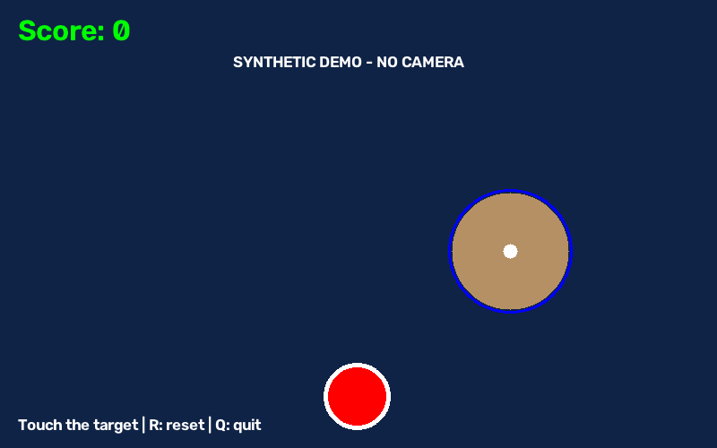
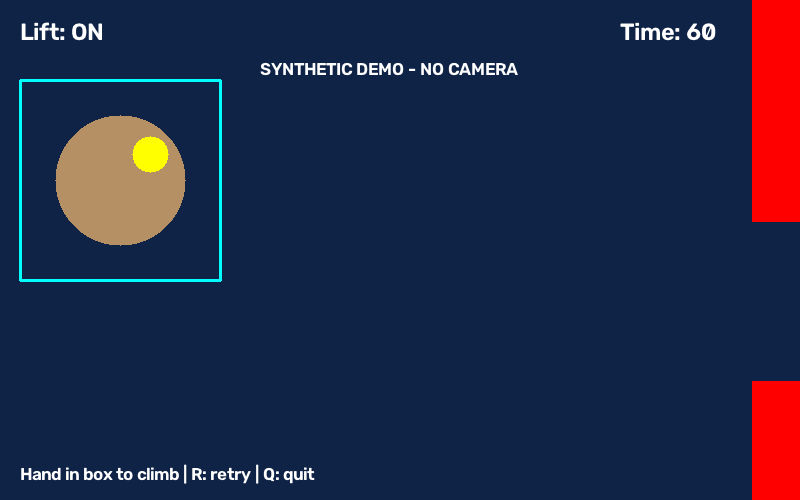
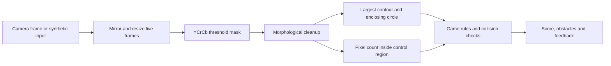

# Gesture-Controlled Vision Games

Two Python/OpenCV games that turn color-segmented webcam input into gameplay: a target-hitting game and a drone obstacle course. This project explores the loop from image capture through segmentation and collision logic to visual feedback.

The detector uses fixed YCrCb color thresholds and geometric rules. It is not a trained hand-pose or gesture-recognition model. **Twelve camera-free tests pass; live webcam play and recognition accuracy have not been verified during repository preparation.**

## Games

| Game | Interaction | Objective |
| --- | --- | --- |
| Target | Largest sufficiently large color-matched region is approximated by a circle | Overlap the target to score and spawn another target |
| Drone | Color-matched pixel count in a control box turns lift on/off | Avoid the ceiling, ground and moving obstacles for the round duration |

Both prepared games use an 800×500 frame. In live mode the camera image is mirrored and resized before detection. Press **Q** to quit and **R** to reset/retry.

## Run with a webcam

Use Python 3.12. Create and activate a virtual environment, then install the GUI-enabled dependencies:

```text
python -m pip install -r requirements.txt
python play.py target --camera 0
python play.py drone --camera 0
```

Choose the camera index for your device. The default is 1, matching the original scripts. A shorter drone round can be selected with `--duration 10`; the prepared version defaults to 60 seconds.

Keep the background plain and adjust lighting. The drone control region is the rectangle `(20,80)` to `(220,280)` in the resized frame. The label “Lift ON” reflects the color-area threshold, rather than a verified open-palm classification.

The GUI-enabled OpenCV dependency is required for windows. Do not install `opencv-python` and `opencv-python-headless` together in the same environment; they provide the same `cv2` module. Live camera/window integration remains to be tested.

## Camera-free demonstration and tests

In a separate headless environment, install:

```text
python -m pip install -r requirements-headless.txt
python -m unittest discover -s tests -v
python play.py target --demo --headless --frames 24 --output results/target-synthetic.png
python play.py drone --demo --headless --frames 12 --output results/drone-synthetic.png
```

`--demo` generates artificial color-matched circles and never opens a camera. `--headless` disables display windows; by itself it does not disable camera capture. Headless runs require a positive frame limit. Demo time advances at a defined 30 frames per simulated second, and `--seed` controls random game elements.

### Target render



### Drone render



These previews test the rendering and processing pipeline with synthetic input. They do not demonstrate real-hand detection or live-game performance.

## Vision pipeline



The original threshold band is retained: YCrCb lower `(0,133,77)`, upper `(255,173,127)`, with a 5×5 morphology kernel. Target detection uses two erosions, two dilations and a 7×7 blur, then requires contour area above 3000 pixels. Drone detection uses one erosion and two dilations, with lift enabled above 9000 masked pixels in its 200×200 region.

Color-matched backgrounds or objects can trigger the detector. Skin appearance, lighting, camera exposure and scaling affect the result. No accuracy dataset, confidence score or calibration procedure is included.

## Game rules and timing

The target has radius 35 pixels and spawns below the top UI area. Collision uses circle overlap. Each contact scores and relocates the target; a relocated target may still overlap a large detected region and score again on the next frame.

The drone retains the 60-second original's per-frame constants: gravity 0.6, lift velocity −8, obstacle speed 4, obstacle width 60, gap height 160 and drone radius 18. A crash and a win are mutually exclusive, and completed/crashed state remains frozen until retry.

Movement is frame-based while live round duration uses a monotonic wall clock. Difficulty therefore varies with capture/processing frame rate. Frame-rate-independent physics, better hand tracking and real-camera evaluation are future work. The “drone” is a game sprite; no physical drone is controlled.

## Verification and source history

All twelve checks passed with Python 3.12.14, NumPy 2.5.4 and OpenCV headless 5.0.0.93. Coverage includes segmentation, ROI isolation, contact scoring, 500 target spawns, lift/gravity, pipe collision, win/crash exclusivity, retry/frozen states, rendering, both headless launch paths and capture-failure cleanup using mocks. See [verification notes](docs/verification.md).

The original target script, 60-second drone script and 10-second drone draft are preserved unchanged in `archive/`. The RMI drone submission has equivalent Python syntax to the 10-second draft with comment/formatting differences; the RMI target submission adds instruction text to the same game logic. The empty practice file is omitted.

The prepared version separates vision, state/drawing and capture into `vision.py`, `games.py` and `play.py`. Preparation adds the common launcher, configurable camera, import-safe modules, reset support for both games, capture cleanup, synthetic demos, tests and mutual exclusion of crash/win on the deadline frame. Original source folders were not edited. Hashes are recorded in [the source inventory](docs/source-inventory.json).
